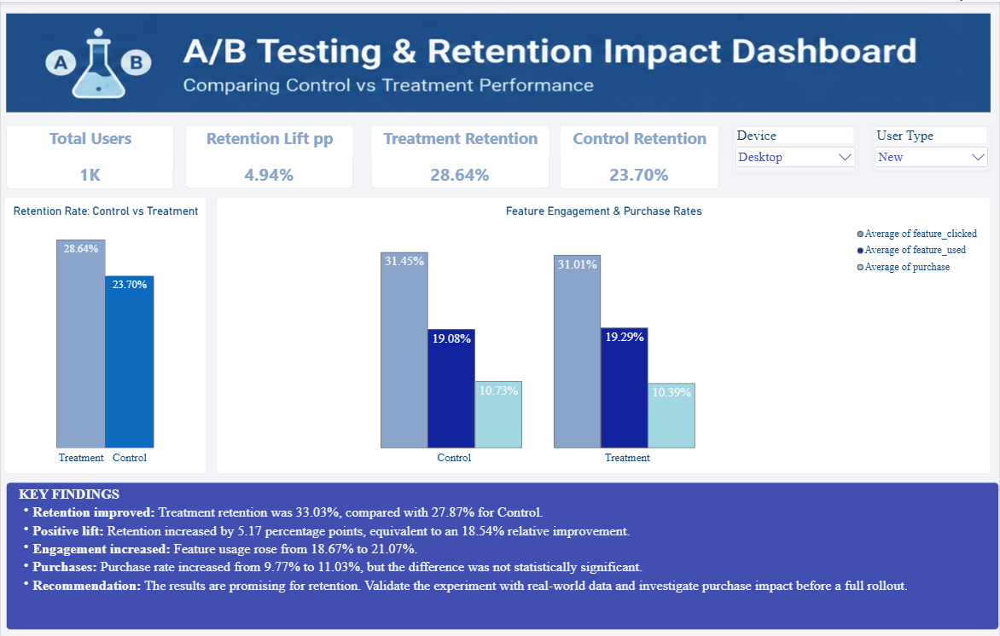

#  A/B Testing Analysis 

## Project Overview

This project analyzes the results of an A/B test to evaluate whether a new product feature improves user retention, feature engagement, and purchase conversion.

Using Python, statistical hypothesis testing, and Power BI, the project compares a Control group with a Treatment group to measure the impact of the feature, assess statistical significance, and translate the results into actionable business recommendations.

The project demonstrates an end-to-end data analytics workflow, from data quality checks and exploratory data analysis to statistical evaluation, visualization, and business decision-making.

**Note:** This project uses a simulated dataset created for learning and portfolio purposes. The results do not represent a real company's experiment or actual customer behavior.

## 📊 Dashboard Preview



## Business Problem

A product team has introduced a new feature and wants to understand whether it improves user behavior and business outcomes.

The key questions are:

- Does the new feature improve Day-7 user retention?
- Does it increase feature clicks and usage?
- Does it improve the purchase conversion rate?
- Are the observed differences statistically significant?
- Should the team consider rolling out the feature to more users?

## Project Objectives

- Compare retention and engagement metrics between Control and Treatment groups.
- Calculate absolute and relative retention lift.
- Apply statistical hypothesis testing to evaluate observed differences.
- Calculate a 95% confidence interval for the retention improvement.
- Build an interactive Power BI dashboard to communicate key findings.
- Provide evidence-based recommendations for product decisions.

## Tools & Technologies

- **Python:** Data analysis and statistical evaluation
- **Pandas:** Data cleaning, manipulation, and aggregation
- **Matplotlib:** Data visualization
- **Statsmodels:** Statistical hypothesis testing
- **Jupyter Notebook:** Analysis workflow and documentation
- **Power BI:** Interactive dashboard development
- **SQL:** Data querying and analytical practice

## Dataset Description

The dataset contains **6,000 simulated user records**, split equally between the Control and Treatment groups.

- Control group: 3,000 users
- Treatment group: 3,000 users

Each row represents one user.

### Key Variables

| Column | Description |
|---|---|
| `user_id` | Unique identifier for each user |
| `group` | Experiment group: Control or Treatment |
| `user_type` | New or Returning user |
| `feature_seen` | Whether the user saw the feature |
| `feature_clicked` | Whether the user clicked the feature |
| `feature_used` | Whether the user used the feature |
| `retained_day7` | Whether the user returned on Day 7 |
| `purchase` | Whether the user made a purchase |
| `signup_date` | User signup date |
| `device` | Device used by the user |
| `region` | User's geographic region |

For the binary outcome variables, `1` represents Yes and `0` represents No.

## Methodology

### 1. Data Quality Checks

- Inspected the dataset structure and data types.
- Checked for missing values and duplicate records.
- Validated categorical values and experiment group assignments.
- Prepared the data for analysis.

### 2. Exploratory Data Analysis

Calculated and compared the following metrics for both groups:

- Day-7 retention rate
- Feature click rate
- Feature usage rate
- Purchase conversion rate

Created visualizations to compare Control and Treatment performance.

### 3. A/B Testing & Statistical Analysis

**Primary metric:** Day-7 retention rate.

The analysis used a two-proportion z-test to evaluate the difference in retention between the two groups.

- **Null hypothesis (H₀):** There is no difference in Day-7 retention rates between the Control and Treatment groups.
- **Alternative hypothesis (H₁):** The Day-7 retention rates differ between the two groups.
- **Significance level:** 5% (α = 0.05).
- **Confidence interval:** 95%.

The analysis also examined feature usage and purchase conversion as secondary metrics.

### 4. Power BI Dashboard

Built an interactive dashboard to present the experiment results, including:

- Total users and retention KPI cards
- Retention comparison between Control and Treatment
- Feature engagement and purchase rate comparisons
- Retention lift
- Device and user-type slicers
- Key findings and business recommendations

The dashboard enables users to explore results across different device types and user segments.

## Key Results

### Day-7 Retention

| Metric | Control | Treatment |
|---|---:|---:|
| Total users | 3,000 | 3,000 |
| Retained users | 836 | 991 |
| Retention rate | 27.87% | 33.03% |

### Retention Improvement

- **Absolute lift:** +5.17 percentage points
- **Relative lift:** +18.54%
- **Additional retained users:** 155 in the Treatment group
- **95% confidence interval:** Approximately +2.84 to +7.49 percentage points
- **P-value:** Approximately 0.0000137

Since the p-value is below 0.05 and the confidence interval excludes zero, the observed retention improvement is statistically significant under the assumptions of the test.

### Engagement & Purchase Results

| Metric | Control | Treatment | Difference |
|---|---:|---:|---:|
| Feature click rate | 31.00% | 32.10% | +1.10 percentage points |
| Feature usage rate | 18.67% | 21.07% | +2.40 percentage points |
| Purchase rate | 9.77% | 11.03% | +1.27 percentage points |

The purchase-rate difference was **not statistically significant** at the 5% level (p ≈ 0.108). Therefore, the results do not provide sufficient evidence to conclude that the feature increased purchases.

The secondary metric tests were exploratory. Their p-values should be interpreted cautiously because multiple outcomes were examined.

## Business Recommendations

Based on the simulated experiment:

1. **Investigate the retention improvement:** The Treatment group showed a statistically significant increase in Day-7 retention.
2. **Examine feature engagement:** Feature click and usage rates were higher in the Treatment group, suggesting potentially improved engagement.
3. **Avoid overstating purchase impact:** The observed purchase-rate increase was not statistically significant.
4. **Validate with real experiment data:** Confirm random assignment, data quality, experiment exposure, and metric definitions before making a product decision.
5. **Assess business impact:** Consider implementation costs, long-term retention, revenue, and potential unintended effects before a full rollout.

## Project Files

| File | Description |
|---|---|
| `ab_test_data` | Simulated dataset used for the analysis |
| `A_B_Testing.ipynb` | Python notebook containing data checks, analysis, statistical tests, and visualizations |
| `A_B_Testing.pbix` | Interactive Power BI dashboard |
| `A_B_Testing_Dashboard.png` | Dashboard preview image |

## How to Explore This Project

1. Download or clone this repository.
2. Open `A_B_Testing.ipynb` in Jupyter Notebook or JupyterLab.
3. Install the required Python libraries if needed:

   ```bash
   pip install pandas matplotlib statsmodels jupyter
   ```

4. Ensure the dataset file is available at the path referenced in the notebook.
5. Run the notebook cells to explore the data and reproduce the analysis.
6. Open `A_B_Testing.pbix` using Power BI Desktop to explore the dashboard.
7. View `A_B_Testing_Dashboard.png` for a quick overview of the visual results.

**Dataset note:** If the uploaded dataset filename has no `.csv` extension, add the actual file extension to the README and notebook path if it is a CSV file.

## Skills Demonstrated

- Data cleaning and quality validation
- Exploratory data analysis
- Python and Pandas
- SQL and analytical thinking
- A/B testing and hypothesis testing
- Two-proportion z-test
- P-values and confidence intervals
- Absolute and relative lift calculations
- KPI development and data visualization
- Power BI dashboards and slicers
- Translating analytical findings into business recommendations


## Conclusion

This project demonstrates how data analytics and statistical testing can help evaluate product changes. The simulated Treatment group achieved higher Day-7 retention, with a statistically significant improvement, while the purchase-rate difference remained statistically inconclusive.

By combining Python-based analysis with an interactive Power BI dashboard, the project presents both the statistical evidence and the business context needed to make more informed product decisions.

---

**Author:** Sneha Nainani

**GitHub:** [snehanainani77-hub](https://github.com/snehanainani77-hub)
